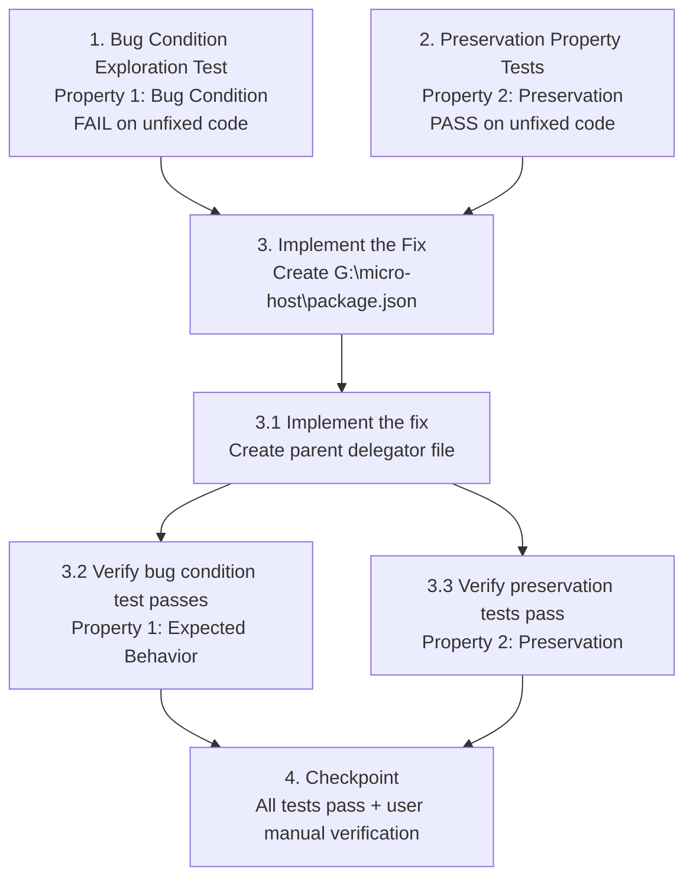

# Implementation Plan

## Overview

This plan fixes the bug where `npm run dev` (and `build`/`preview`/`test`) fail with `ENOENT` when executed from the parent directory `G:\micro-host` (which has no `package.json`) instead of the project root `g:\micro-host\micro-host`. The fix is purely additive: a single new minimal parent delegator `package.json` at `G:\micro-host\package.json` that mirrors the existing delegator style and forwards scripts down into the `micro-host` subfolder via `npm --prefix`. No existing file is modified, and no new dependencies or tooling are introduced.

The tasks follow the bugfix workflow: first surface the bug condition on unfixed code (Property 1), then record preservation baselines on unfixed code (Property 2), then implement the fix, and finally verify both that the bug is resolved and that existing behavior is unchanged.

## Tasks

- [x] 1. Write bug condition exploration test
  - **Property 1: Bug Condition** - Parent Directory ENOENT Failure
  - **CRITICAL**: This test MUST FAIL on unfixed code - failure confirms the bug exists
  - **DO NOT attempt to fix the test or the code when it fails**
  - **NOTE**: This test encodes the expected behavior - it will validate the fix when it passes after implementation
  - **GOAL**: Surface a counterexample that demonstrates the bug exists by confirming npm cannot find a `package.json` at `G:\micro-host`
  - **Scoped PBT Approach**: For this deterministic config-file bug, scope the property to the concrete failing cases: invoking each of the four npm scripts (`dev`, `build`, `preview`, `test`) with cwd set to `G:\micro-host`
  - Confirm no `package.json` currently exists at `G:\micro-host` (the root cause): run `Test-Path G:\micro-host\package.json` and assert it returns `False`
  - Run `npm run dev` with cwd `G:\micro-host` and capture the output; assert it fails with `npm error code ENOENT` referencing `G:\micro-host\package.json` (from Bug Condition `isBugCondition` in design: `commandFailsWithENOENT` for these inputs)
  - Run `npm run build` with cwd `G:\micro-host` and assert the same `ENOENT` failure
  - Run `npm run test` with cwd `G:\micro-host` and assert the same `ENOENT` failure
  - Run on UNFIXED code
  - **EXPECTED OUTCOME**: Tests FAIL (this is correct - it proves the bug exists); the `ENOENT` error is the counterexample demonstrating the missing parent delegator
  - Document the counterexamples found: record the exact `ENOENT` error message and confirm the cause is the absent `package.json` at `G:\micro-host` (matches `isBugCondition`: `input.command IN [...]` AND `input.cwd == "G:\\micro-host"` AND `NOT packageJsonExists(input.cwd)`)
  - Mark task complete when the absence is confirmed, the ENOENT failures are reproduced, and counterexamples are documented
  - _Requirements: 1.1, 1.2_

- [x] 2. Write preservation property tests (BEFORE implementing fix)
  - **Property 2: Preservation** - Existing Delegation Behavior Unchanged
  - **IMPORTANT**: Follow observation-first methodology
  - Observe behavior on UNFIXED code for non-buggy inputs (cases where `isBugCondition` returns false)
  - Observe: running `npm run` (no script arg) from `g:\micro-host\micro-host` lists `dev`, `build`, `preview`, `test` scripts from the existing delegator
  - Observe: running `npm run` (no script arg) from `g:\micro-host\micro-host\workspace-prototype` lists the Vite scripts directly
  - Write property-based checks capturing observed behavior patterns across the directory domain (from Preservation Requirements in design):
    - For cwd `g:\micro-host\micro-host`: npm finds and lists the existing delegator scripts (preserves Requirement 3.1, 3.3)
    - For cwd `g:\micro-host\micro-host\workspace-prototype`: npm finds and lists the Vite scripts directly (preserves Requirement 3.2)
    - For an arbitrary directory with no `package.json` and no delegator: npm fails with `ENOENT`, with no new error-reporting system (preserves Requirement 3.4)
  - Record a byte-for-byte checksum (e.g., `Get-FileHash`) of `g:\micro-host\micro-host\package.json` and `g:\micro-host\micro-host\workspace-prototype\package.json` as the pre-fix baseline for later comparison
  - Property-based testing generates many test cases for stronger guarantees; here the "cases" are the distinct (command, cwd) tuples across the directory domain
  - Run tests on UNFIXED code
  - **EXPECTED OUTCOME**: Tests PASS (this confirms baseline behavior to preserve)
  - Mark task complete when observations are recorded, property checks pass on unfixed code, and checksums are saved as baseline
  - _Requirements: 3.1, 3.2, 3.3, 3.4_

- [x] 3. Fix for parent directory ENOENT (missing `package.json` at `G:\micro-host`)

  - [x] 3.1 Implement the fix
    - Create the new file `G:\micro-host\package.json` with the exact contents specified in the design:
      ```json
      {
        "name": "micro-host-parent-delegator",
        "private": true,
        "description": "Parent delegator for Post Card Spatial OS (delegates to micro-host)",
        "scripts": {
          "dev": "npm --prefix micro-host run dev",
          "build": "npm --prefix micro-host run build",
          "preview": "npm --prefix micro-host run preview",
          "test": "npm --prefix micro-host test"
        }
      }
      ```
    - **OUT-OF-WORKSPACE-FILE FLAG**: `G:\micro-host\package.json` is OUTSIDE the Kiro workspace root (`g:\micro-host\micro-host`). This is intentional and explicitly user-approved (documented in bugfix.md). Implementation must flag this so the reviewer is aware the new file lives outside the workspace tree. No other out-of-workspace writes are required.
    - **GIT CONSIDERATION**: `G:\micro-host\package.json` is outside the git repo rooted at `g:\micro-host\micro-host\.git`, so git will NOT track it by default. This is acceptable: the fix is a local parent-directory convenience delegator. Confirm this is the intended behavior (the file need not be committed to the repo). Do NOT modify any `.gitignore` or git config to include it.
    - Mirror the existing delegator style in `g:\micro-host\micro-host\package.json`: same shape (name, private, description, four scripts), using `npm --prefix` delegation. The target subfolder is `micro-host` (one level down from the parent), and the `test` script omits `run` to match the existing delegator exactly.
    - No `dependencies` or `devDependencies` block — it is a pure delegator introducing no new packages or build systems.
    - Purely additive: do NOT modify `g:\micro-host\micro-host\package.json` or `workspace-prototype\package.json`.
    - _Bug_Condition: isBugCondition(input) where input.command IN ["npm run dev", "npm run build", "npm run preview", "npm run test"] AND input.cwd == "G:\\micro-host" AND NOT packageJsonExists(input.cwd)_
    - _Expected_Behavior: expectedBehavior(result) from design - the fixed system succeeds by delegating down through micro-host to workspace-prototype, starting the Vite dev server for dev and running the corresponding task for build/preview/test, without requiring a manual directory change_
    - _Preservation: Preservation Requirements from design - running scripts from the correct project root g:\\micro-host\\micro-host or directly from workspace-prototype continues to work exactly as before, existing files are not modified, and directories with no delegator continue to fail with ENOENT by design_
    - _Requirements: 2.1, 2.2, 2.3, 2.4_

  - [x] 3.2 Verify bug condition exploration test now passes
    - **Property 1: Expected Behavior** - Parent Directory Delegation Succeeds
    - **IMPORTANT**: Re-run the SAME test from task 1 - do NOT write a new test
    - The test from task 1 encodes the expected behavior
    - When this test passes, it confirms the expected behavior is satisfied
    - Confirm `package.json` now exists at `G:\micro-host`: run `Test-Path G:\micro-host\package.json` and assert it returns `True`
    - Run `npm run` (no script arg) with cwd `G:\micro-host` and assert npm now parses the file and lists `dev`, `build`, `preview`, `test` — proving npm finds the new delegator and resolves the scripts
    - This confirms the delegation chain `G:\micro-host\package.json` -> `micro-host` -> `workspace-prototype` is wired (Requirement 2.4)
    - Run bug condition exploration test from step 1
    - **EXPECTED OUTCOME**: Test PASSES (confirms bug is fixed - npm no longer fails with ENOENT from the parent directory)
    - _Requirements: 2.1, 2.2, 2.3, 2.4_

  - [x] 3.3 Verify preservation tests still pass
    - **Property 2: Preservation** - Existing Delegation Behavior Unchanged
    - **IMPORTANT**: Re-run the SAME tests from task 2 - do NOT write new tests
    - Run preservation property tests from step 2
    - Confirm existing delegator at `g:\micro-host\micro-host` still lists its scripts when running `npm run` from that directory (Requirement 3.1, 3.3)
    - Confirm `workspace-prototype` still lists its Vite scripts directly when running `npm run` from that directory (Requirement 3.2)
    - Confirm an arbitrary directory with no `package.json` still fails with `ENOENT` with no new error-reporting system introduced (Requirement 3.4)
    - Confirm `g:\micro-host\micro-host\package.json` and `g:\micro-host\micro-host\workspace-prototype\package.json` are byte-for-byte unchanged: recompute their checksums and compare against the pre-fix baseline recorded in task 2 (Requirement 3.3)
    - **EXPECTED OUTCOME**: Tests PASS (confirms no regressions - existing behavior is unchanged after the purely additive fix)
    - _Requirements: 3.1, 3.2, 3.3, 3.4_

- [x] 4. Checkpoint - Ensure all tests pass
  - Ensure all verification checks pass: bug condition test passes (task 3.2), preservation tests pass (task 3.3), existing files confirmed unchanged.
  - **User manual verification (do NOT start the long-running dev server)**: Recommend the user manually run `npm run dev` from `G:\micro-host` to confirm the Vite dev server boots end-to-end, validating the full delegation chain `G:\micro-host\package.json` -> `micro-host` -> `workspace-prototype` -> `vite` (Requirements 2.1, 2.4). The agent must NOT start the long-running dev server itself.
  - Optionally recommend the user run `npm run build` from `G:\micro-host` as a quick non-blocking end-to-end check that the build task executes in `workspace-prototype` (Requirement 2.2).
  - Ensure all tests pass, ask the user if questions arise.

## Task Dependency Graph



```json
{
  "waves": [
    {
      "tasks": ["1", "2"],
      "dependsOn": []
    },
    {
      "tasks": ["3.1"],
      "dependsOn": ["1", "2"]
    },
    {
      "tasks": ["3.2", "3.3"],
      "dependsOn": ["3.1"]
    },
    {
      "tasks": ["4"],
      "dependsOn": ["3.2", "3.3"]
    }
  ]
}
```

- **Wave 1 (Tasks 1 and 2)**: Bug condition exploration and preservation baseline tests run on unfixed code. These two tasks are independent of each other and can run in parallel. Both establish the unfixed baseline before any implementation.
- **Wave 2 (Task 3.1)**: Implement the fix by creating the parent delegator file. Depends on Wave 1 completing so the unfixed state is documented first.
- **Wave 3 (Tasks 3.2 and 3.3)**: Verify the bug condition test now passes (3.2) and preservation tests still pass (3.3). Both depend on the file being created in 3.1. These are independent of each other and can run in parallel.
- **Wave 4 (Task 4)**: Final checkpoint confirming all verification passes plus user manual verification. Depends on both 3.2 and 3.3 passing.

## Notes

- **Out-of-workspace file**: The new file `G:\micro-host\package.json` is intentionally placed outside the Kiro workspace root (`g:\micro-host\micro-host`). This is explicitly user-approved per the bugfix requirements. The reviewer should be aware this file is not visible in the workspace file tree.
- **Git tracking**: Because `G:\micro-host\package.json` is outside the git repo rooted at `g:\micro-host\micro-host\.git`, git will not track it by default. This is acceptable for a local parent-directory convenience delegator. No `.gitignore` or git config changes should be made to include it.
- **No long-running servers**: The agent must NOT start the Vite dev server (`npm run dev`) during verification. Task 3.2 uses `npm run` (no script arg) to confirm npm parses the file without booting a server. The end-to-end dev server check is deferred to the user in Task 4.
- **Purely additive fix**: No existing `package.json` is modified. Preservation verification (Task 3.3) confirms existing files are byte-for-byte unchanged via checksum comparison against the baseline recorded in Task 2.
