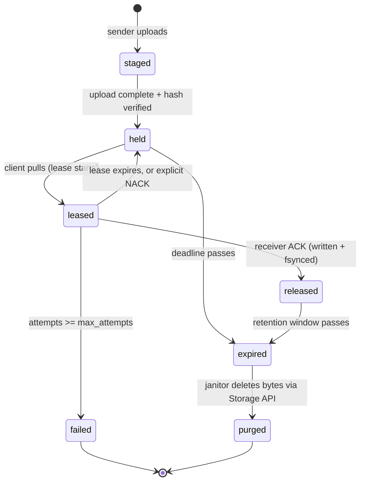

# Store-and-forward mailbox

The database is the mailbox. A PC is a client. Bytes are written once and survive
either side going away.

Schema: `001_plane_holds.sql` then `002_mailbox.sql`.

## What was kept from the usual advice, and what it misses

The common description of store-and-forward is right about the shape: persist every
message, track a status, ACK on receipt, cache locally, re-sync on reconnect. Four
things it usually leaves out, each of which is the actual bug in production:

| Common advice | The gap | What this schema does |
|---|---|---|
| `pending` / `delivered` | No state for *claimed but not finished*. Two clients pull the same row and both fetch 200 MB. | `leased` with a visibility timeout. `for update skip locked` makes the claim atomic. |
| "ACK the message" | ACK before the local write loses the message on a crash. ACK after it can deliver twice. | Write → fsync → ACK. Duplicates are possible and harmless; loss is not. |
| Timestamps for ordering | Two rows in the same millisecond, clock skew, a system clock step — cursor skips or repeats rows. | `seq bigint` from a sequence. Monotonic, no clock involved. |
| Delete once delivered | History disappears, and the sender loses their receipt. | `released` keeps the row; only the bytes purge, after a retention window. |

## State machine



`held` is the pending state. `released` is delivered. The rest exist because
something goes wrong.

## The protocol, in five calls

```jsonc
// 1. Pull. Claims rows for one recipient.
POST /mailbox/pull   { "toCard": "c-42", "limit": 20, "leaseSec": 300 }
->  200 { "planes": [ { "id": "...", "seq": 918, "manifest": {...}, "cursor": "storage-url" } ],
          "leaseExpiresAt": "2026-11-18T21:07:00Z" }

// 2. Fetch the bytes with the plane token (see plane.v1.json x-token-policy).

// 3. Write locally, fsync the file, THEN update the local index. Not before.

// 4. ACK. Idempotent — a duplicate ACK returns false and changes nothing.
POST /mailbox/ack    { "planeId": "...", "recipientKeyId": "...", "signature": "...", "disposition": "taken" }
->  200 { "delivered": true }

// 5. If the fetch failed for a retryable reason, hand it back instead of leaving
//    it to time out. After max_attempts it goes to failed, not back to pending.
POST /mailbox/nack   { "planeId": "...", "reason": "disk_full" }
->  200 { "result": "requeued" | "failed" }
```

## Client loop

```
on start, and on reconnect:
  cursor := local index's last seq, or 0
  planes := mailbox_since(toCard, cursor)      # history, delivered included
  merge into local cache, dedupe by plane id

loop:
  batch := mailbox_pull(toCard, 20, 300)
  for each plane in batch:  fetch bytes -> verify sha256 -> write -> fsync
  for each written plane:   mailbox_ack(planeId, keyId, sig)
  sleep backoff(1s -> 60s, with jitter) when the batch is empty
```

Polling is the baseline and it is enough. Push (Postgres `listen/notify`, or a
WebSocket) is a latency optimisation, never a correctness requirement — a client
that only ever polls must still converge.

## Failure cases, stated plainly

| Failure | Result | Recovery |
|---|---|---|
| Client dies mid-fetch | Row stays `leased` until the lease expires, then becomes eligible again. `attempts` is already incremented. | Automatic. Nothing to clean up. |
| Client ACKs, then crashes before writing | **Message lost.** This is why ACK comes last. | Prevented by ordering, not by retry. |
| Client writes, then crashes before ACK | Duplicate delivery on next pull | Receiver dedupes on plane id |
| Two clients, same recipient | One wins each row via `skip locked`; no double fetch | Both converge after ACK |
| Clock steps backward on a client | Cursor is server-side `seq`, so ordering is unaffected | None needed |
| Sender deletes the card | Row is keyed by plane id, not card id. Survives. | None needed — this is the point |
| 1 GB storage cap reached | Uploads fail with a quota error | Retention window + purge, or a paid plan |

## Security, because a mailbox is a reading room

A row is addressed by `to_card` and a token. Two things must hold:

1. **The pull is authorised server-side.** `to_card` alone must never be enough —
   otherwise anyone who can guess a card id reads someone's mail. The relay proxy
   validates the caller's key against `to_card` before calling `mailbox_pull`.
2. **The token is still the gate on bytes.** A mailbox row without a valid token is
   a filename, not a file. Tokens stay hashed, one-time, and bound to plane +
   recipient + method.

## What this means for the contract

The sender-facing envelope does not change. `plane.v1.json` gains `x-store-and-forward`
to record the mapping, and `hold.state` gains `leased` so the UI can honestly say
"someone is fetching this" instead of "waiting".

The distinction worth keeping: **a hold is where bytes sit; the mailbox is who owns
them.** Before ACK, the sender owns the cargo and the receiver has a claim on it.
After ACK, the receiver owns it and the sender has a receipt. That transition is the
only thing that has to be exactly once — everything else is retryable.
